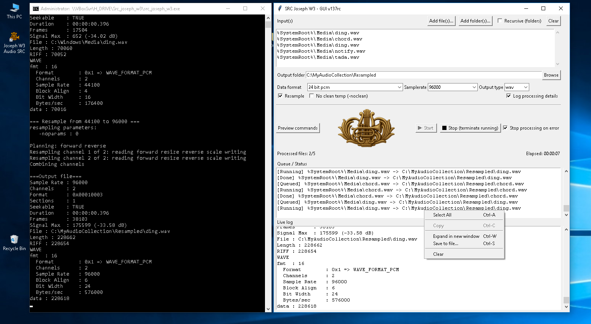

# SRC Joseph W3

> Audio sample rate converter with command-line and graphical interfaces for Windows

## Overview

**SRC Joseph W3** is an audio sample rate conversion utility. It resamples audio files from one sample rate to another (for example, 44100 Hz to 96000 Hz) with a choice of output format, bit depth, and codec. Runs on Windows in both command-line and graphical modes.

## Features

- Sample rate conversion (`-sr<number>`, e.g. `-sr96000`)
- Wide audio format support: WAV, AIFF, FLAC, AU, CAF, IFF, PAF, VOC, W64, RAW, MAT4/5, PVF, SDS, SD2, XI, and more
- Output format selected by file extension
- Multiple output encoding modes:
  - PCM: 8/16/24/32-bit, signed/unsigned
  - Float 32
  - u-law, a-law
  - IMA ADPCM, MS ADPCM (WAV only)
  - GSM 6.10 (WAV only)
  - DWVW 12/16/24-bit (AIFF only)
- Two modes of operation:
  - **Command-line** (`src_joseph_w3.exe`) — for scripting and automation
  - **GUI** (`src_joseph_w3_GUI.exe`) — drag-and-drop visual interface

## Repository Layout

```
SRC_Joseph_W3/
├── src_joseph_w3.exe          # Command-line resampler (C)
├── src_joseph_w3_GUI.exe      # GUI wrapper (Python + Tkinter)
├── libsndfile-1.dll           # Audio I/O library (LGPL v2.1+)
├── readme.txt                 # Quick reference
├── help.txt                   # Full CLI option reference
├── src_joseph_w3_GUI.xml      # GUI configuration
└── Dev/
    ├── src_joseph_w3_GUI.py   # GUI source code
    ├── make_exe.bat           # PyInstaller build script
    ├── requirements.txt       # Python dependencies
    ├── src_joseph_w3_GUI.png  # Banner/logo image
    └── src_joseph_w3_GUI.ico  # Application icon
```

## Usage

### Command Line

```bash
src_joseph_w3.exe [options] <input_file> <output_file>
```

Examples:

```bash
# Resample to 96 kHz 24-bit WAV
src_joseph_w3.exe -sr96000 -pcm24 input.aiff output.wav

# Resample to 48 kHz FLAC
src_joseph_w3.exe -sr48000 input.wav output.flac
```

### GUI Mode

Run `src_joseph_w3_GUI.exe`, drag and drop an audio file into the window, select the target sample rate and format, then click Convert.

## Building the GUI from Source

Requirements: Python 3.8+, Windows

```bash
cd Dev
pip install -r requirements.txt
python src_joseph_w3_GUI.py
```

Build a standalone executable:

```bash
make_exe.bat
```

## Dependencies

- [libsndfile](https://github.com/libsndfile/libsndfile) — audio file read/write
- [Pillow](https://python-pillow.org/) — image handling for the GUI
- [tkinterdnd2](https://github.com/pmgagne/tkinterdnd2) — drag-and-drop support for Tkinter

## License

Free for non-commercial use only.  
`libsndfile-1.dll` is licensed under the LGPL v2.1 or later.

## Author

Albert Vik — AlbertVik@ukr.net  
Build: #2510301

## Screenshot


